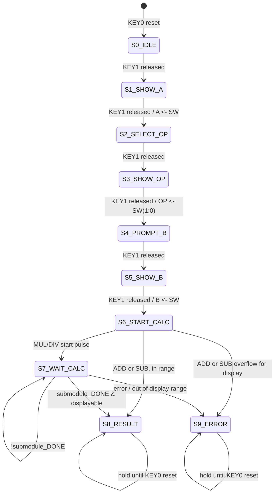

# Calculator FSM state diagram

Asynchronous active-low KEY0 reset always returns to S0_IDLE and clears values and DONE.
The hardware KEY1 button event is generated once on a **stable release**, not every 50 MHz tick.

Submodule state machines:
- Multiplier10: S_IDLE -> S_CALC (10 rounds) -> S_SIGN -> S_DONE
- Divider10: S_IDLE -> S_SUB -> S_TEST / S_RESTORE (10 rounds) -> S_SIGN_Q -> S_SIGN_R -> S_DONE
